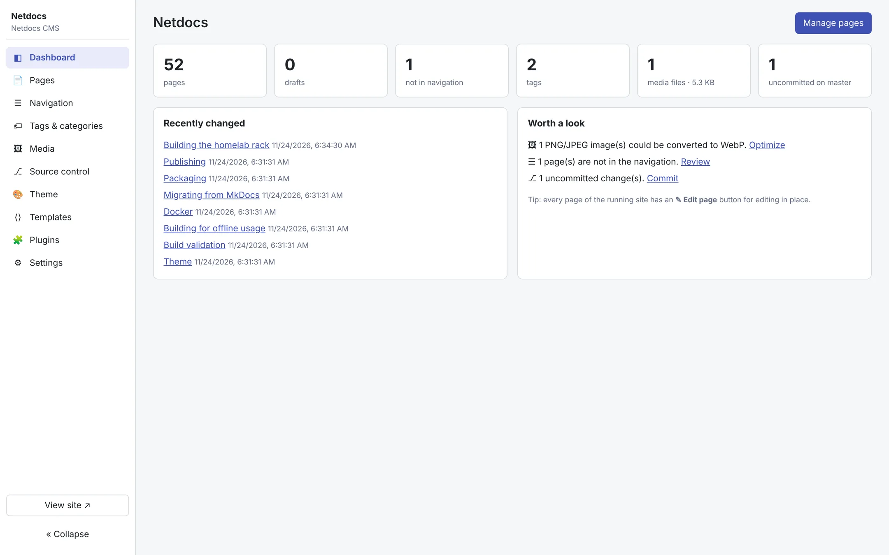

# Local CMS

`netdocs serve` includes a browser-based CMS. It can edit pages visually, manage images, edit the
navigation, configure plugins, the theme and templates, and commit to git.

Changes are saved to the project's own files: Markdown pages under `docs/`, settings in
`appsettings.json`, and template overrides in the theme folder. There is no database. The CMS only
runs while `netdocs serve` does, and it has no effect on `netdocs build`.

^^^

^^^ The dashboard shows what's in the site and what could use attention.

## Starting the CMS

Run the dev server from the folder that holds `appsettings.json`:

```bash
netdocs serve
```

The console prints two addresses:

```text
Serving Netdocs at http://localhost:8000 (Ctrl+C to stop)
CMS at http://localhost:8000/__cms/ (turn off with --no-cms)
```

Open the second one for the admin screens. While the server runs, every page of the site also shows a
small **Edit** toolbar, so you can browse to a page and start editing it right there.

To serve the site without the CMS or the page toolbar, pass `--no-cms`:

```bash
netdocs serve --no-cms
```

!!! info "Only on your own computer"

    The CMS answers only on `localhost`, and every request has to carry a random token that changes
    each time `netdocs serve` starts. Other websites open in your browser cannot reach it, and it is
    never part of a build: `netdocs build` output contains no CMS code.

## What's in it

| Screen | What you do there |
|---|---|
| **[Pages](visual-editor.md)** | Find, create, rename, move and delete pages. Open one in the visual editor. |
| **[Navigation](site-management.md#navigation)** | Drag pages into the site's menu, add sections, set icons and titles. |
| **[Tags & categories](site-management.md#tags-and-categories)** | Rename, merge and remove tags and blog categories across every page. |
| **[Media](site-management.md#media)** | Upload, move and delete images; convert them to WebP or shrink them; find unused files. |
| **[Source control](site-management.md#source-control)** | Review changes, stage, commit, switch branches, pull and push. |
| **[Theme](site-management.md#theme)** | Colors, fonts, logo, language and Material's feature switches. |
| **[Templates](site-management.md#templates)** | Override any theme template with a live preview at phone, tablet and desktop sizes. |
| **[Plugins](site-management.md#plugins)** | Turn plugins on and off and edit their options in forms. |
| **[Settings](site-management.md#settings)** | Site name, URL, repository and the raw `appsettings.json`. |

The site rebuilds after each save, and any page you have open in another tab reloads by itself, the
same as when you edit files in your own editor. You can mix the two freely. If a file changes on disk
while you are editing it in the CMS, saving asks whether to reload the file or keep your version.

## Next steps

- **[Visual editor](visual-editor.md):** write pages with callouts, tabs, card grids, images, links,
  diagrams and tables without writing Markdown.
- **[Managing the site](site-management.md):** navigation, media, git, theme, templates and plugins.
