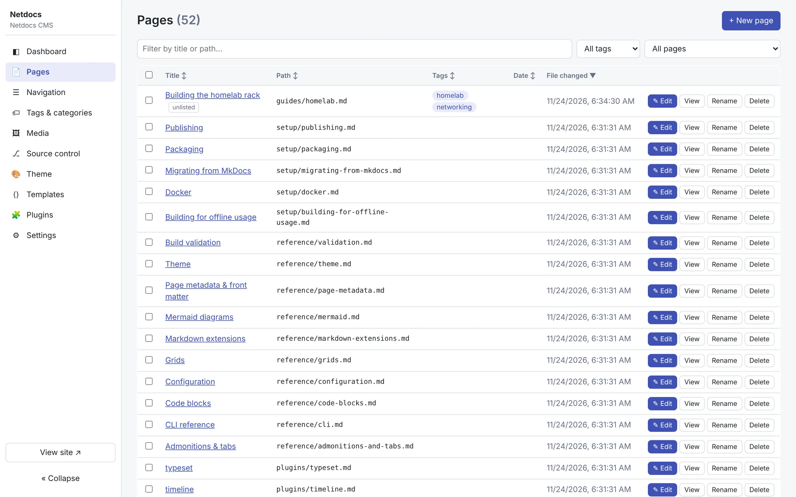
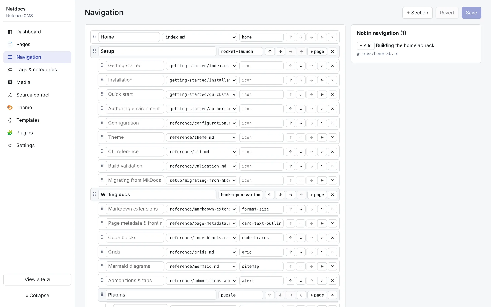
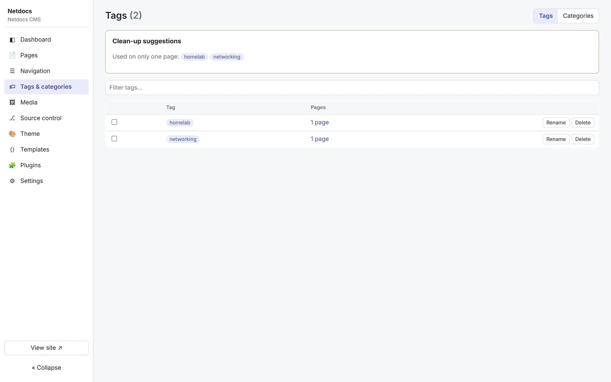
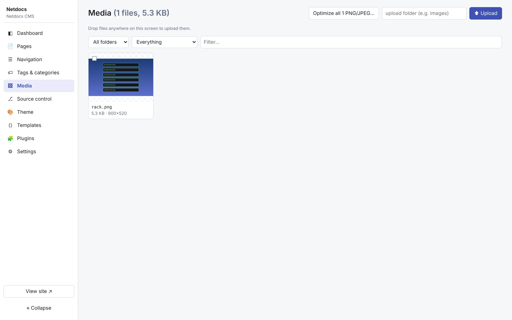
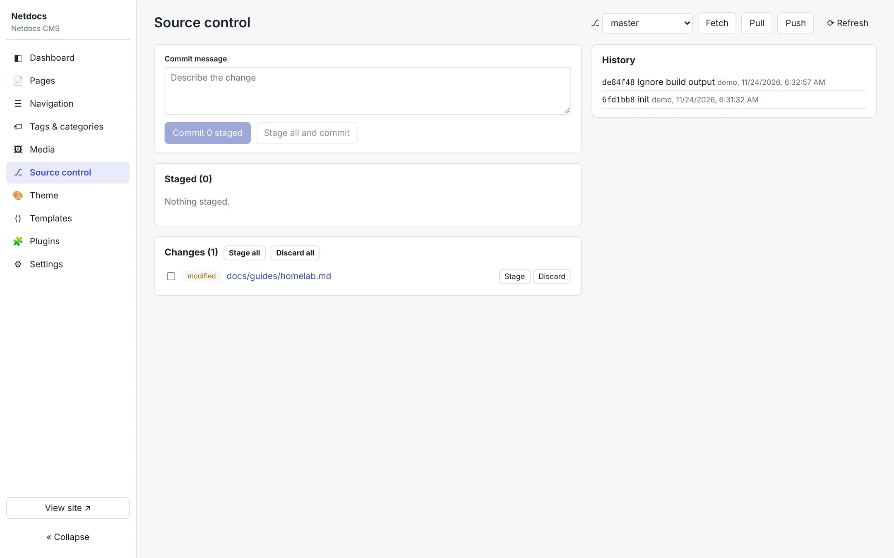
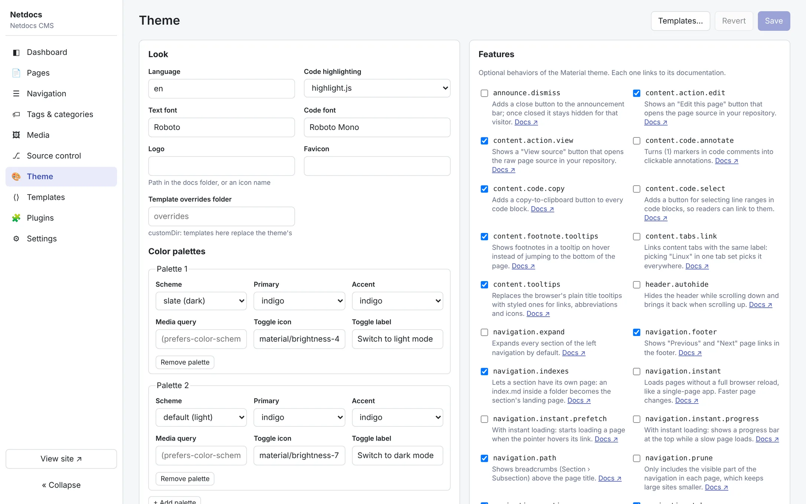
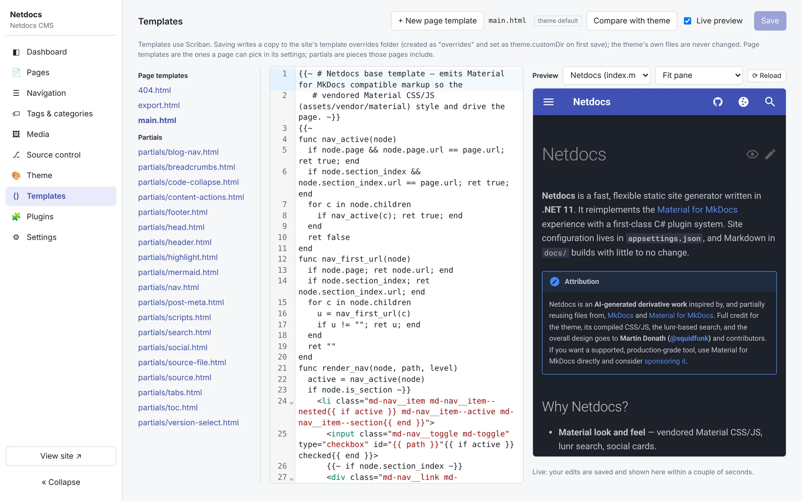
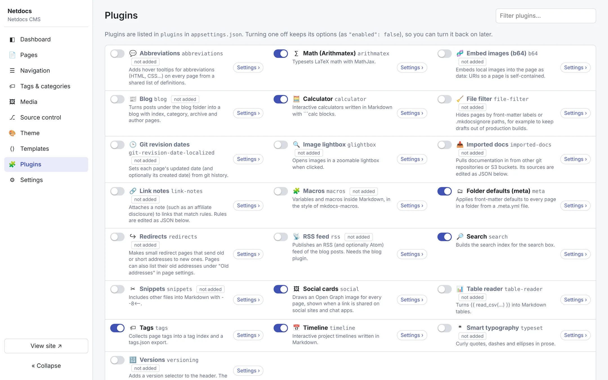
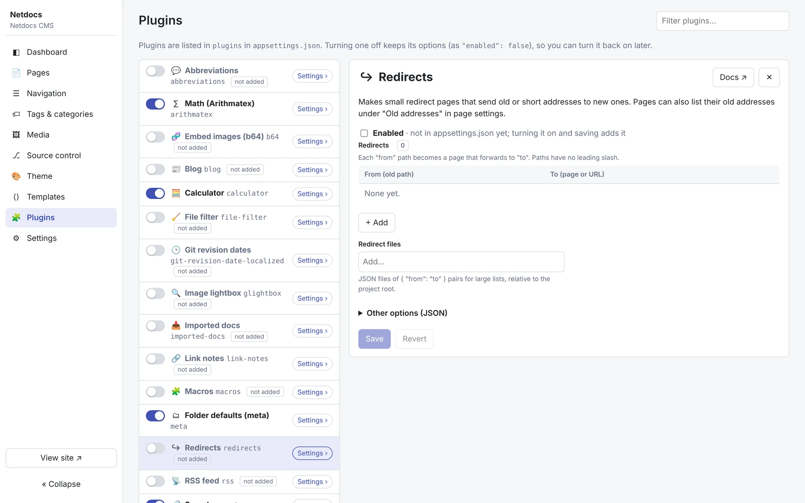
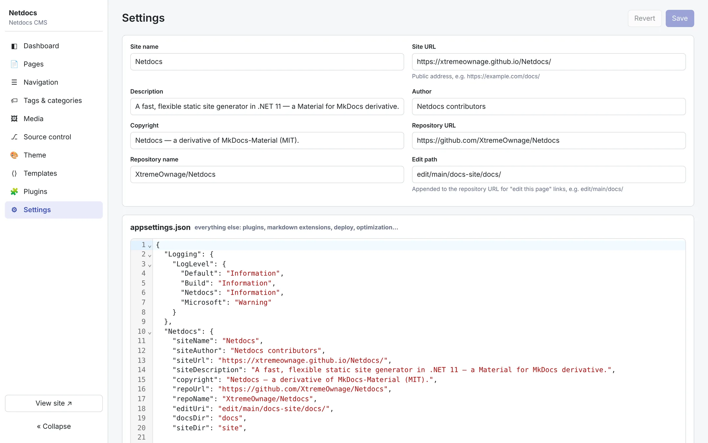

# Managing the site

Besides the [visual editor](visual-editor.md), the CMS has a screen for each part of the site. All of
them write to the same files you would edit by hand, so you can switch between the CMS and your own
editor at any time.

## Pages

**Pages** lists every page with its title, path, tags, date and last change. You can filter it by text,
by tag, or to drafts, published pages, blog posts or pages missing from the navigation, and sort any
column. The dashboard's counts link straight to those lists.

^^^

^^^ Every page, with edit, view, rename, move and delete on each row.

- **New page** asks for a title and a file name (filled in from the title), can add the page to the end
  of the navigation, and opens it in the editor.
- **Rename** and **Move** update every link to the page across the site, and its place in the
  navigation.
- **Delete** shows which pages link to it first.

## Navigation

The navigation screen edits `nav` in `appsettings.json` as a tree. Drag items, or use the arrows, to
move, indent and outdent them. Set each item's title and icon, add sections, and add pages from the
list of pages that aren't in the menu yet. Removing an item from the navigation keeps the page itself.

^^^

^^^ Pages that aren't in the menu yet are listed on the right.

## Tags and categories

This screen lists every tag, and every blog category, with the pages that use it. **Rename** changes a
term on every page at once, **Merge** folds several terms into one, and **Delete** removes a term from
all of its pages. **Clean-up suggestions** points out terms that look alike (`homelab` and `home-lab`)
and terms used only once, which are often typos.

^^^

^^^ Rename, merge and delete apply to every page that uses the term.

## Media

The media screen shows every image and file under `docs/`, by folder, with a preview and the pages
that use it.

^^^

^^^ Drop files anywhere on the screen to upload them.

- **Upload:** drop files onto the screen, or use **Upload** and pick a folder.
- **Move** and **Delete:** a moved file keeps working, because the pages that link to it are updated.
- **Convert to WebP** and **Shrink to this width** make large images smaller. The dashboard suggests
  this when it finds big PNG or JPEG files.
- **Not used by any page** lists files that nothing links to. Images used only by a template or the
  config show up here too, so check before deleting them.

## Source control

When the site is in a git repository, **Source control** shows what changed, grouped by folder. You can
view each file's diff, stage or discard a file, a folder or everything, write a message and commit. The
header switches or creates branches, and fetches, pulls and pushes. **History** lists recent commits.

^^^

^^^ Stage, commit and push without leaving the browser.

Pushing and pulling use your own git setup and credentials, the same as running `git push` yourself.

## Theme

The theme screen edits the `theme` section of `appsettings.json`: language, fonts, logo and favicon,
the color palettes (with their light and dark toggle), the code highlighting style, the template
overrides folder, and every Material feature switch. Each switch says what it does and links to its
documentation.

^^^

^^^ Feature switches come with a short explanation of what each one does.

## Templates

**Templates** lists every template and partial of the theme. Editing one saves your version to the
template overrides folder, so the theme's own files are never changed. **Compare with theme** shows
what you changed, and **Revert to theme** deletes your version. You can also add page templates of your
own and pick them per page in the page settings.

^^^

^^^ The preview rebuilds as you type, at any of the preview sizes.

With **Live preview** on, the preview rebuilds the site with your edit a moment after you stop typing,
and shows its progress while it does. The size menu previews the page at phone (390px), tablet
(820px), laptop (1366px), desktop (1920px) and extra wide (2560px) widths, or fits the pane.

## Plugins

The plugins screen lists every plugin Netdocs has, with a switch to turn it on or off, and
**Settings ›** to edit its options. Options are forms: switches, numbers, lists, choices, colors, and
tables for maps such as the redirects plugin's `redirect_maps`. Anything a form doesn't cover can be
edited as JSON.

^^^

^^^ Plugins that aren't in your config yet show as off. Turning one on adds it.

^^^

^^^ Map options, such as redirects, are edited as a table.

Some plugins keep their data outside `appsettings.json`, and get their own editors:

| Plugin | Edits |
|---|---|
| [Abbreviations](../plugins/abbreviations.md) | The abbreviation list, with its definitions. |
| [Blog](../plugins/blog.md) | The authors file, with names, descriptions and avatars. |
| [File filter](../plugins/file-filter.md) | `.file-filter.yml` as a form or as YAML, and the `.mkdocsignore` list. |
| [Social](../plugins/social.md) | The footer's social links, with an icon preview. |

Turning a plugin off writes `"enabled": false` and keeps its options, so turning it back on restores
them.

## Settings

**Settings** edits the site name, URL, description, author, copyright and repository links, and has
the full `appsettings.json` in a code editor for everything else. Saving checks the file first, and
won't write a config the site can't build with.

^^^

^^^ The common settings as a form, and the whole file below.
