# Visual editor

The visual editor shows a page the way your readers will see it, with your theme and all of its
styles, and lets you change it in place. Open it from **Pages** in the CMS, or click **Edit** in
the toolbar on any page while `netdocs serve` runs.

^^^
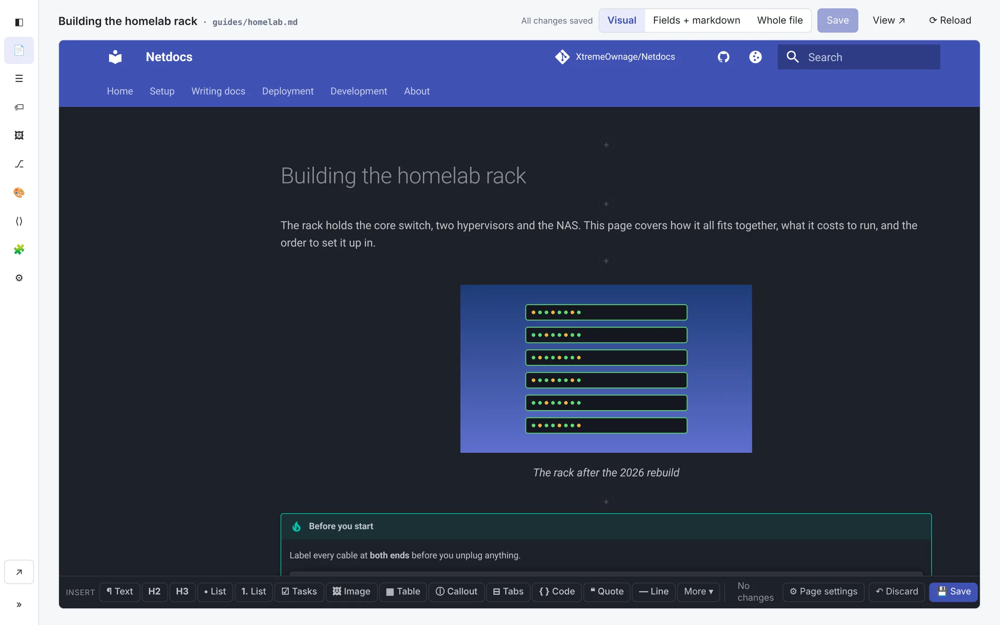
^^^ The page as readers see it. Hovering a block shows its tools, and the bar at the bottom inserts new blocks.

The editor works on **blocks**: a paragraph, a heading, a list, a callout, a set of tabs, an image,
a code block, a card grid. Saving writes only the blocks you changed back into the Markdown file, so
everything you didn't touch stays exactly as it was, down to the spacing.

## Three ways to edit a page

The switch at the top of the page editor picks how you work. You can change it at any time.

| View | Use it for |
|---|---|
| **Visual** | Writing and rearranging content on the rendered page. |
| **Fields + markdown** | The page settings as a form, next to the page's Markdown. |
| **Whole file** | The raw file, front matter included, in a code editor. |

## Writing text

Click any paragraph, heading, list or quote and type. Selecting text brings up a formatting bar:

^^^
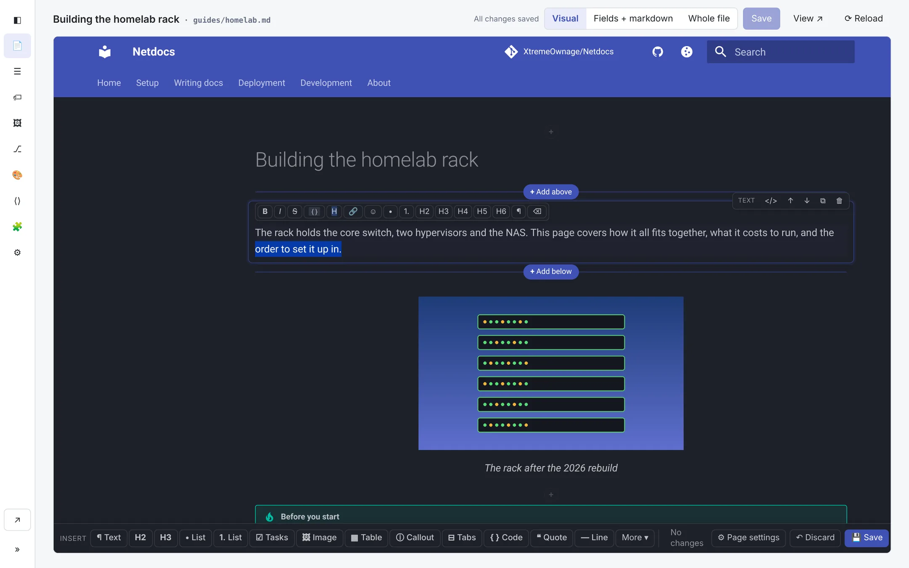
^^^ Bold, italic, strikethrough, code, highlight, links, icons, lists and headings H2 to H6.

- **Bold**, *italic*, ~~strikethrough~~, `code` and ==highlight== all toggle off when you press
  them again.
- **🔗 Link** opens a picker that lists your pages, or takes any web address.
- **☺ Icon** opens the icon browser (below).
- In a list, **Tab** or **⇥** moves an item one level in, under the item above it. **Shift+Tab** or
  **⇤** moves it back out.
- Task list boxes can be ticked right on the page.

### Icons

The icon browser searches every icon set Netdocs ships: Material Design, Octicons, Font Awesome and
Simple Icons. Pick one and it is inserted as a shortcode such as `:material-server:`.

^^^
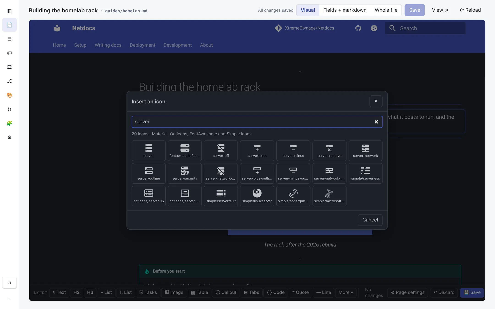
^^^ Search by name, then click an icon to insert it.

## Adding blocks

Hover between two blocks and click **+**, or use the **Insert** bar at the bottom of the page. The
common blocks have their own buttons, and **More** lists every block type with a search box:
headings, lists, task lists, tables, images, callouts, tabs, code, diagrams, card grids, grids,
footnotes, math and more.

^^^
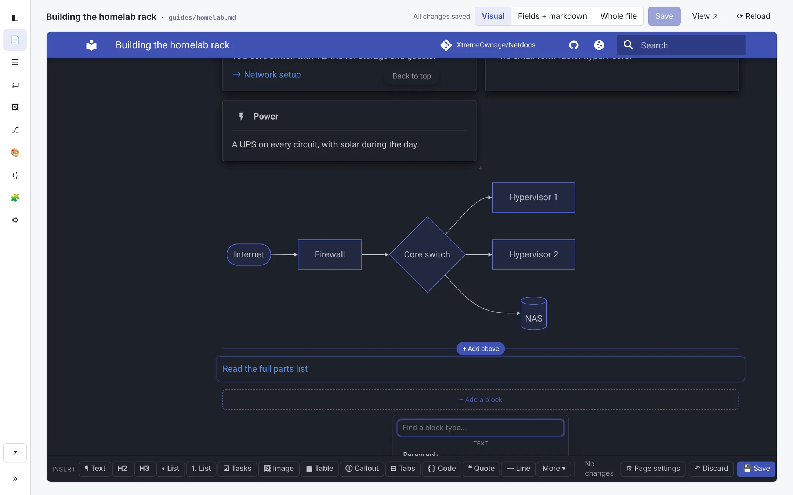
^^^ Type to filter the list, and press Enter to insert the first match.

A new text block has its placeholder selected, so you can start typing straight away. Other blocks
open their editor. Every block also has tools for moving it up or down, duplicating it, deleting it,
and opening its Markdown.

## Editing structured blocks

Clicking a callout, tab set, table, image, link, code block, diagram or grid opens a panel on the right.
Changes show on the page as you make them. There is no Apply button: close the panel with **Done**
when you're finished. **Edit source** switches that block to its Markdown at any point.

### Callouts

Pick the type from a grid that shows each type in its own color and icon, or type any other type
name. Then choose whether the box is always open (`!!!`), collapsed (`???`) or collapsible and open
(`???+`), and set or hide its title.

^^^
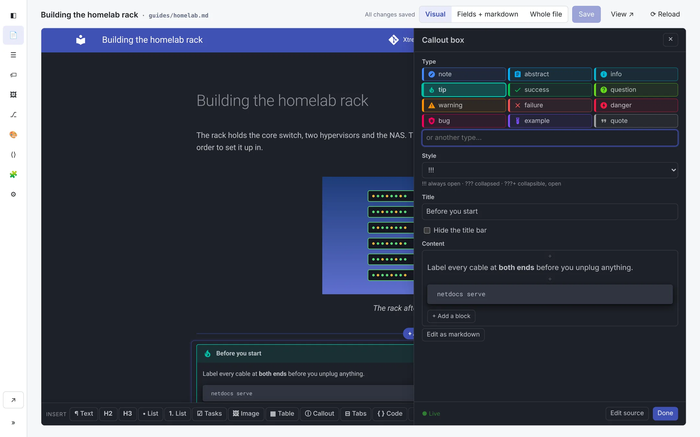
^^^ Each callout type is shown in the color and icon the theme gives it.

### Content inside callouts, tabs and grids

The content of a callout, of each tab, of each card and of each grid cell is edited the same way as
the page itself. You can type text in place, add any block between the others with **+**, and move or
delete blocks. A code block, table, image or nested callout inside opens its own panel on top of the
first one. **‹ Back** returns to the outer panel, and the page keeps updating the whole time.

^^^
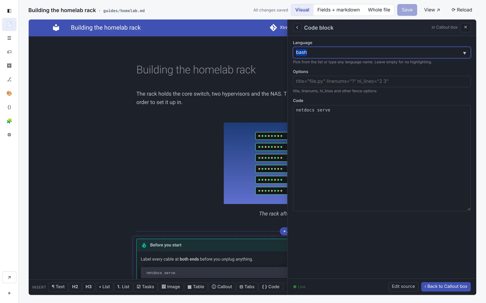
^^^ A block inside a callout opens in its own panel. The header shows where it lives.

### Tabs

Each tab has a title and its own content. Add, remove and reorder tabs in the panel.

^^^
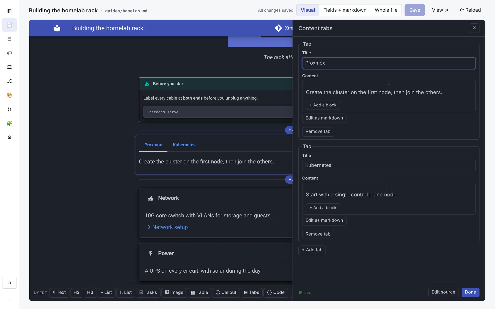
^^^ Each tab's content is a full block list.

### Card grids and grids

A [card grid](../reference/grids.md) gets a form for each card: an icon (from the icon browser), a
large icon option, the title, a line under the title, the card's text and a link at the bottom with
its own icon. Cards can be reordered, duplicated and removed.

^^^
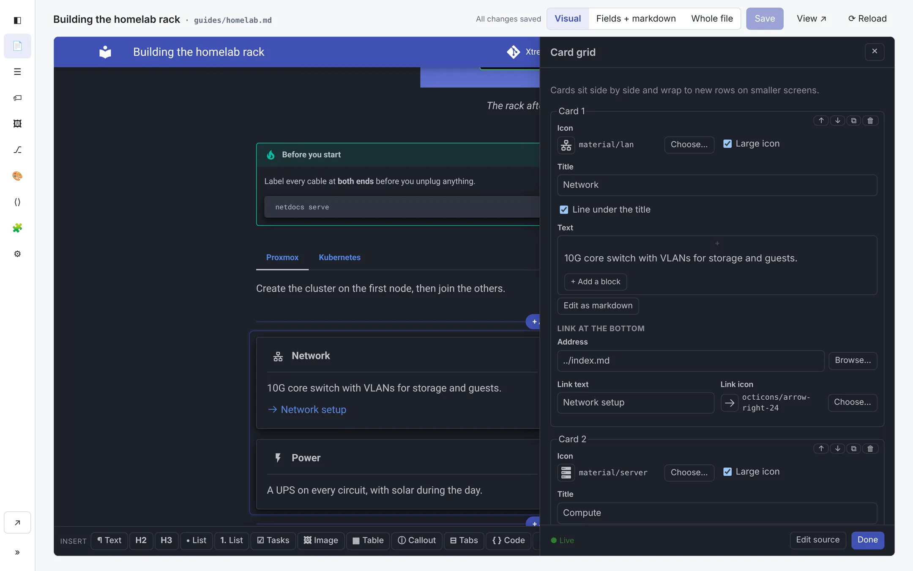
^^^ Each card has an icon, a title, text and an optional link.

A plain grid (`<div class="grid" markdown>`) lists its cells. Each block inside is one cell, and
cells are added and edited like any other blocks.

### Images

The image panel shows a preview and edits everything about the image: the file (from your media or a
new upload), alt text, a caption, width, placement (inline or floated left or right with the text
wrapping beside it), a tooltip, and a link the image opens, optionally in a new tab.

^^^
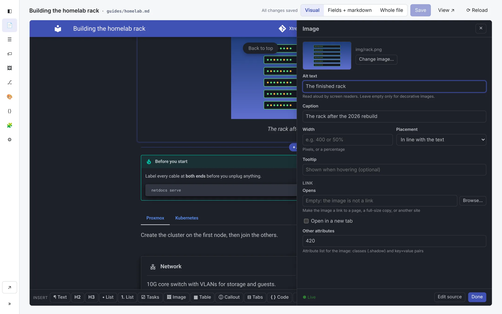
^^^ Captions are written with the figure syntax described below.

A caption turns the image into a figure:

```markdown
^^^
{ width="420" }
^^^ The rack after the 2026 rebuild
```

In edit mode, a floated image stays inside its own block, so its outline and the insert points stay in
place. On the published page, the text after it wraps beside it as usual.

### Links

A block that is just a link, such as a "Read more" line or a button, gets a link form. The link can be
text or an image, and you can set its address (with a page picker), a tooltip, whether it opens in a
new tab, extra attributes such as `.md-button`, and footnote markers after it.

^^^
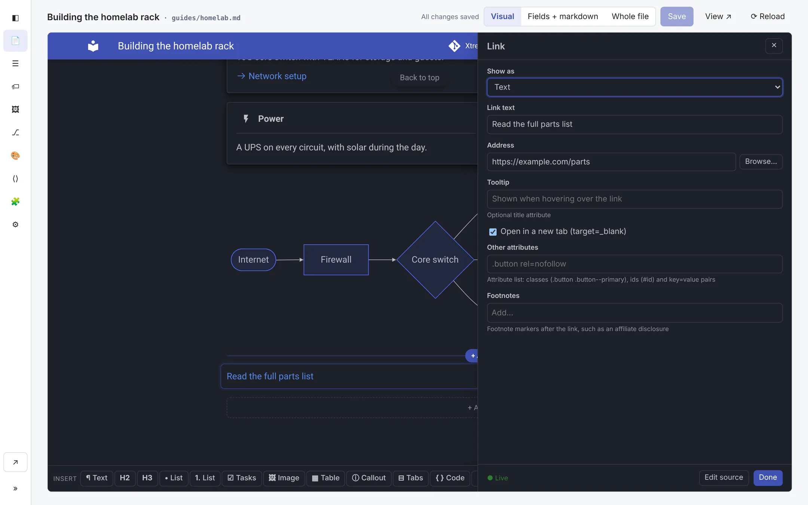
^^^ Links to other pages are written as relative paths, so they keep working when the site moves.

### Code blocks

Set the language (with suggestions for every language the highlighter knows), fence options such as
`title="app.py" linenums="1" hl_lines="2 3"`, and the code itself.

### Mermaid diagrams

Diagrams get their own panel with a title, a theme (`default`, `neutral`, `dark`, `forest` or
`base`), a look (classic or hand-drawn) and the diagram text. The page redraws the diagram as you type.
**Start from an example** fills in a working diagram of any common type: flowchart, sequence, class,
state, entity relationship, Gantt, pie, mind map, timeline, git graph and user journey.

^^^
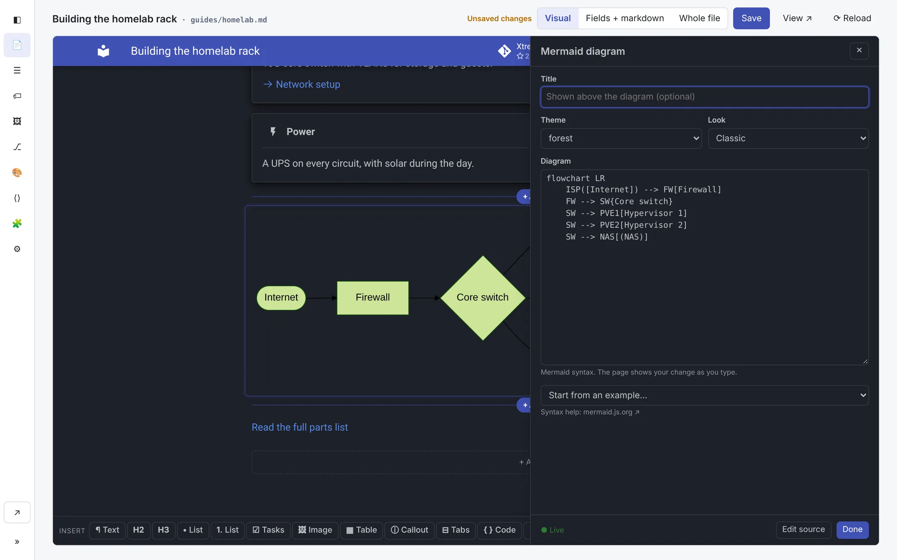
^^^ The title, theme and look are saved in the diagram's own front matter.

See [Mermaid diagrams](../reference/mermaid.md#themes-per-diagram) for the syntax this writes.

### Timelines

A ```` ```timeline ```` block from the [timeline plugin](../plugins/timeline.md) opens as a form:
the title, the date formats, whether the date table shows and whether readers can edit exclusions,
then one row per input date, computed date and excluded date. Dates have a date picker when the
block's `date_format` uses only `YYYY`, `MM` and `DD` tokens. A computed date is set as an earlier
name plus or minus a number of days; an `expr` the form can't split stays as text. **Timeline** in
the insert menu adds a small working example.

^^^
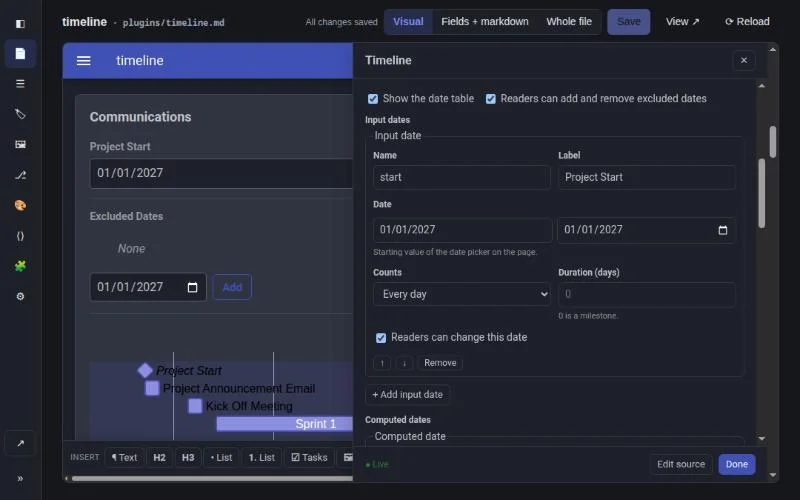
^^^ The page redraws the timeline as you change the form.

Blocks with YAML the form doesn't cover, such as comments or keys the plugin doesn't read, open in
the code editor instead, so nothing in them is lost.

### Tables

Tables open in a grid where you can type into cells, add and remove rows and columns, and set each
column's alignment.

## Page settings

**Page settings** in the editor toolbar, or clicking the page title, opens the page's front matter as a
form: the title, browser tab and navigation titles, description, URL slug, tags (with suggestions
from the rest of the site), template, icon, the parts of the page to hide (table of contents,
navigation, breadcrumbs, footer, tags), old addresses that should redirect here, and an image for
social cards and blog listings. Blog posts also get the published and updated dates, authors,
categories, a draft switch, and their title and summary in the RSS feed and on the tags page. Empty fields fall back to their defaults, and each one says what that
default is.

^^^
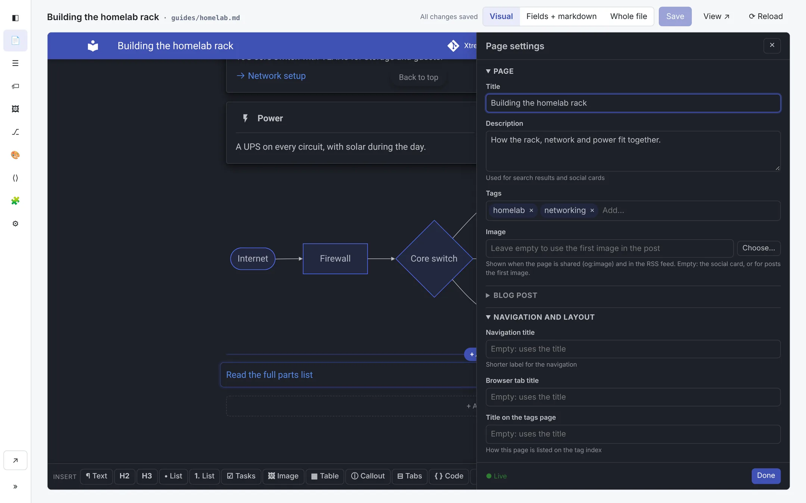
^^^ Front matter as a form.

## Pages made by plugins

Some pages get part of their content from a plugin when the site builds, such as the tags index or a
blog's post list. The editor shows that part as a read-only preview with a link to the plugin's
settings, so it's clear what you can edit there and what the plugin generates.

## Saving

**Save** (or Ctrl+S) writes the changed blocks to the file, and the site rebuilds. Unsaved
blocks are marked with a bar on their left edge. If the file changed on disk since you opened it,
because of another editor, a `git pull` or a script, saving asks you to choose:

- **Reload the file:** drop your edits and load what's on disk.
- **Save my version:** overwrite the file with what you see.
- **Cancel:** keep editing and decide later.
