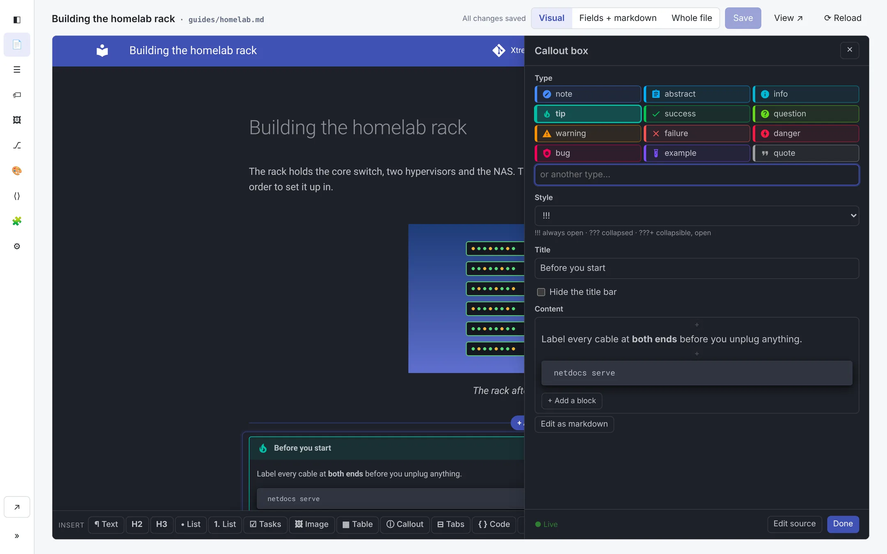

# Netdocs

**Netdocs** is a fast, flexible static site generator written in **.NET 11**, with a
built-in visual editor. It reimplements the
[Material for MkDocs](https://squidfunk.github.io/mkdocs-material/) experience with a
first-class C# plugin system. Site configuration lives in **`appsettings.json`**, and Markdown
in `docs/` builds with little to no change.

`netdocs serve` also hosts a local CMS with a visual editor at `http://localhost:8000/__cms/`. It
edits your Markdown and config files directly, with no database. See [Local CMS](cms/index.md).

^^^

^^^ Editing a callout in the visual editor.

!!! important "Attribution"
    Netdocs is an **AI-generated derivative work** inspired by, and partially reusing
    files from, [MkDocs](https://www.mkdocs.org/) and
    [Material for MkDocs](https://github.com/squidfunk/mkdocs-material). Full credit for
    the theme, its compiled CSS/JS, the lunr-based search, and the overall design goes to
    **Martin Donath ([@squidfunk](https://github.com/squidfunk))** and contributors. If
    you want a supported, production-grade tool, use Material for MkDocs directly and
    consider [sponsoring it](https://github.com/sponsors/squidfunk).

## Why Netdocs?

- **Material look and feel** — vendored Material CSS/JS, lunr search, social cards.
- **Configuration in `appsettings.json`** — the `Netdocs` section, via
  `Microsoft.Extensions.Configuration`.
- **Fast parallel builds** — a parallel render pipeline over Markdig.
- **C# plugin system** — blog, tags, search, social, snippets, and more, all extensible.
- **Live reload** — `netdocs serve` runs Kestrel with a WebSocket live-reload watcher.
- **Visual editor** — `netdocs serve` includes a local CMS for editing pages and managing media,
  navigation, plugins, templates and git. See [Local CMS](cms/index.md).

## Quick links

- **[Installation](getting-started/installation.md)** — build or install the CLI.
- **[Quick start](getting-started/quickstart.md)** — scaffold and build a site.
- **[Configuration](reference/configuration.md)** — the `appsettings.json` schema.
- **[Plugins](plugins/index.md)** — the built-in plugin catalogue.
- **[Publishing](setup/publishing.md)** — deploy to GitHub Pages.

## At a glance

```pwsh
# Build a site (looks for ./appsettings.json, or pass --config)
netdocs build

# Serve with live reload
netdocs serve --port 8000
```

See **[Getting started](getting-started/index.md)** to go from zero to a running site.
